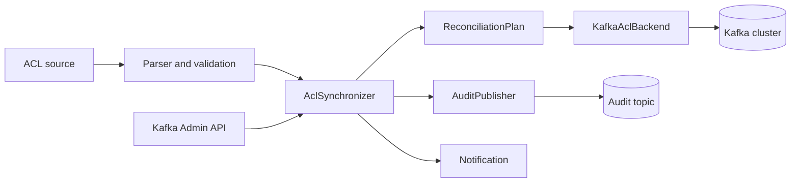
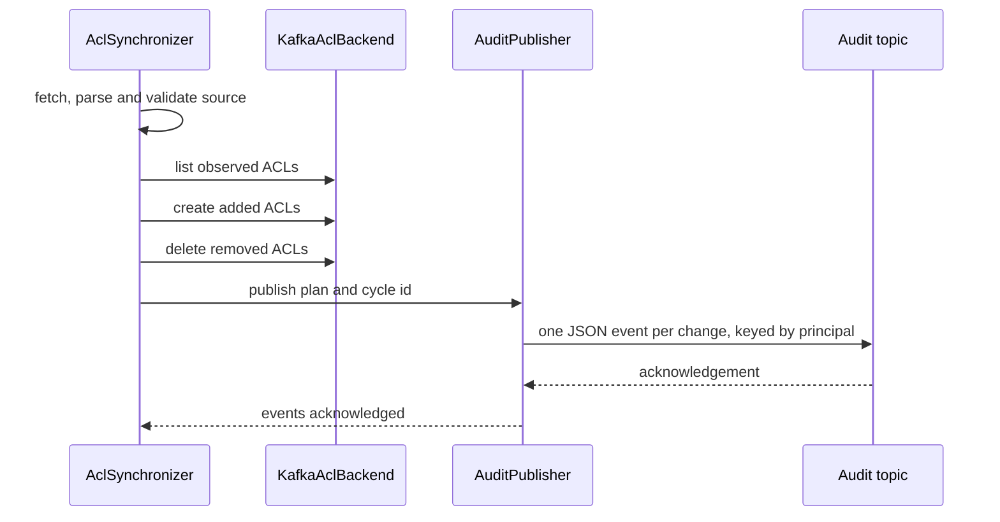

# ACL Drift Watch

Reconciles Kafka ACLs against a reviewed source file and streams every applied change to an audit topic.



## Why

Kafka ACLs drift. Someone grants a permission by hand during an incident, a script removes one, and the cluster no longer matches the policy that was reviewed and merged. Reconcilers fix the drift, but they usually report it in a log line that rotates away within days. When an audit question arrives about a permission that appeared and vanished overnight, the evidence is gone. ACL Drift Watch keeps the cluster in line with the source of truth and leaves an ordered, durable record of every change it made, readable by anyone with access to a topic rather than the cluster.

## How it works

Each cycle reads the ACL document from the configured source, parses and validates it, then lists the ACLs the cluster actually has. The difference becomes a plan of additions and removals. Additions are applied before removals, and a failed create batch never leads to a delete. After a successful, non-dry-run apply, `AclSynchronizer` builds an `AuditPublisher` from the `audit` section of the configuration and calls `publish(plan, cycleId)` with a fresh cycle id from `AuditPublisher.newCycleId()`. The publisher turns every added and removed binding into an `AclChangeEvent`, which flattens the principal, resource type, pattern type, resource name, operation, permission, host, timestamp and cycle id into one line of JSON, and sends it to the audit topic keyed by principal, so all changes of one principal land on the same partition. Each send waits for the broker acknowledgement within `audit.delivery.timeout.ms`; a send that fails is logged and skipped, because the ACLs are already applied and the next cycle recomputes from Kafka. Dry runs, failed cycles and empty plans never reach the publisher, and `close()` flushes the producer when the process stops.



## Key decisions

- Additions are applied before removals, and a failed create batch stops the cycle before any delete. The cost is that a half-applied plan leaves extra permissions in place until the next cycle, which is safer than removing access a service still needs.
- The audit publisher is built only after the Admin API calls return, so an event always describes a change that happened. The cost is that a crash between the apply and the publish loses that cycle's events.
- Events are keyed by principal, which keeps one principal's history in order on a single partition. The cost is that a topic with many principals spreads across partitions and a consumer must read all of them for a global view.
- The source is re-read every cycle and a source failure never falls back to cached state. The cost is more requests to the source, in exchange for never applying a policy that could not be read.

## Tech stack

- Java 25 with virtual threads for the cycle worker
- Apache Kafka clients 4.3.1, Admin API and producer
- Typesafe Config for layered configuration
- SnakeYAML and Apache Commons CSV for the ACL parsers
- Maven with Spotless, SpotBugs and JUnit 5
- Docker and Docker Compose for the local demo

## Quick start

Prerequisites: JDK 25 and Maven 3.9 or newer, or Docker with Compose for the demo stack.

```bash
mvn -B package
docker compose up
java -jar target/acl-drift-watch-2.0.0.jar --dry-run
```

The demo stack starts a single Kafka broker with SASL PLAIN, seeds a manager principal, and runs the reconciler against `example/demo-acls.csv`.

| Variable | What it sets | Default |
| --- | --- | --- |
| `KSM_READONLY` | Disables synchronization and only validates | `false` |
| `KSM_REFRESH_FREQUENCY_MS` | Milliseconds between cycles, zero for a single run | from reference config |
| `KSM_EXTRACT_ENABLE` | Prints the cluster ACLs in the configured format and exits | `false` |
| `ADMIN_CLIENT_BOOTSTRAP_SERVERS` | Bootstrap servers for the Admin API client | none, required |
| `ADMIN_CLIENT_SECURITY_PROTOCOL` | Security protocol for the Admin API client | from reference config |
| `ADMIN_CLIENT_SASL_MECHANISM` | SASL mechanism for the Admin API client | from reference config |
| `ADMIN_CLIENT_SASL_JAAS_CONFIG` | JAAS configuration for the Admin API client | from reference config |
| `SOURCE_CLASS` | Source implementation to read the ACL document from | from reference config |
| `SOURCE_FILE_FILENAME` | Path of the ACL file for the file source | from reference config |

## Usage

```bash
$ java -jar target/acl-drift-watch-2.0.0.jar --dry-run
ADD (User:app,Allow,TOPIC,orders,Read)
REMOVE (User:legacy,Allow,TOPIC,orders,Write)
```

## Project structure

```text
src/main/java/io/conduktor/ksm/          entry point, synchronizer, config
src/main/java/io/conduktor/ksm/audit/    change event and audit publisher
src/main/java/io/conduktor/ksm/backend/  Kafka Admin API backend
src/main/java/io/conduktor/ksm/parser/   CSV and YAML ACL parsers
src/main/java/io/conduktor/ksm/source/   file, HTTP, Git and S3 sources
src/test/java/io/conduktor/ksm/          unit and integration tests
example/                                 demo ACL file and client properties
```

## Limitations

- The audit topic is not created by the tool; it must exist and be writable by the reconciler's principal.
- Events are published after the apply, so a process crash in between loses that cycle's history.
- Only ACL bindings are reconciled; quotas, topic configs and role bindings are out of scope.
- The audit publisher does not retry indefinitely; a broker outage during publish is logged and the cycle ends.

## License

MIT. The project builds on [kafka-security-manager](https://github.com/conduktor/kafka-security-manager) and keeps its reconciliation model.
